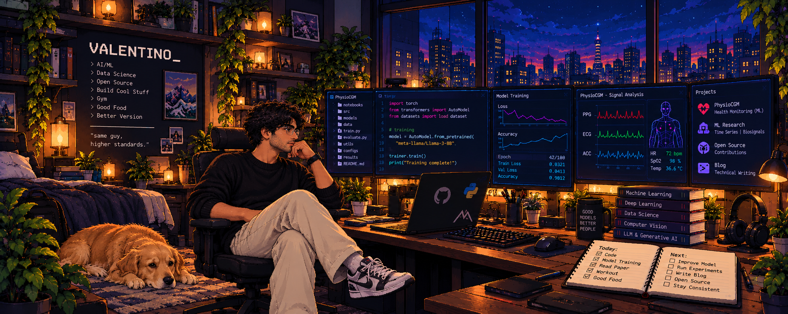

  <!-- Header Banner -->
  

    

  <!-- Typing SVG -->
  

  

    <strong>Data Science Undergraduate • ML Systems Architect • Edge AI & RAG Specialist</strong>
  

  

    🎓 JNNCE (CGPA: 8.93) &nbsp;|&nbsp; 💡 Patent Applied for Edge Health AI
  

  <!-- Social Badges -->
  

    
    
    
  

---

### 🌟 Executive Summary

I am a **Computer Science (Data Science)** undergraduate at **Jawaharlal Nehru New College of Engineering (JNNCE)** with a track record of engineering end-to-end machine learning systems, low-latency edge inference engines, multimodal retrieval-augmented generation (RAG) pipelines, and production MLOps workflows.

- 🔬 **Applied ML & Edge AI:** Architected a patent-applied predictive wearable framework achieving **0.023 ms inference latency** and **42,700+ samples/sec** edge throughput.
- ⚡ **Scalable Data & Inference:** Processed datasets exceeding **120K+ samples** using modular ETL pipelines, FastAPI microservices, and automated testing suites.
- 🧠 **GenAI & Multimodal Systems:** Implemented RAG and Vision-Language models using **BLIP-2, Sentence-Transformers, FAISS, and local Mistral LLMs** with sub-180 ms retrieval.
- 🏆 **Community & Leadership:** Student Coordinator at *Datorum* (Data Science Forum), National Hackathon Finalist, Technical Head of *HackFest-1.0*, and Python Instructor.

 

---

### 🛠️ Technical Arsenal

| Domain | Technologies & Frameworks |
| :--- | :--- |
| **Languages** |    |
| **Deep Learning & CV** |     |
| **Machine Learning** |    |
| **LLMs & GenAI** |     |
| **Data & Feature Eng.** |     |
| **Databases & Vector DBs** |    |
| **Backend & MLOps** |     |
| **Analytics & Viz** |     |
| **OS & Environments** |    |

---

### 📊 GitHub Activity & Metrics

  
  

  

  <picture>
    <source media="(prefers-color-scheme: dark)" srcset="https://raw.githubusercontent.com/DvP05/DvP05/output/github-contribution-grid-snake-dark.svg" />
    <source media="(prefers-color-scheme: light)" srcset="https://raw.githubusercontent.com/DvP05/DvP05/output/github-contribution-grid-snake.svg" />
    
  </picture>

---

### 🤝 Let's Connect & Collaborate

I am always keen on discussing **Applied Machine Learning, MLOps Architecture, Multimodal Systems, Edge AI**, and **open-source contributions**.

  
  &nbsp;
  
  &nbsp;
  

  

 

  Built with care by <a href="https://github.com/DvP05">Darshan Valentino Prasad</a>. Continuous iteration and learning in progress.

